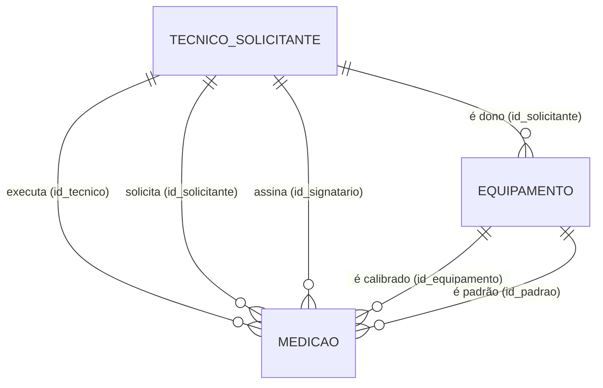

# 01 – Organização dos Dados (Modelo Conceitual Simplificado)

**Projeto Aplicado I 2026.2 – UniSENAI | Empresa parceira: Schulz S.A.**
**Tema:** automação da emissão de certificados de calibração

## 1. Ponto de partida

Na Fase 01 identificamos que a causa raiz do problema é a ausência de um fluxo integrado entre a
saída da Máquina de Medição por Coordenadas (MMC/Calypso), as planilhas de apoio e o certificado.
Hoje a mesma informação aparece em vários lugares, escrita de formas diferentes:

| Informação | Onde aparece | Como aparece |
|---|---|---|
| Técnico | Calypso (`Report!B11`) | `José A. Rosa Jr` |
| Técnico | Certificado e aba Complemento (B76) | `Jose Alcides Rosa Junior` |
| Padrão MMC | Calypso (`Report!D11`) e aba BANCO DE DADOS | `500008` (número) |
| Padrão MMC | Certificado e aba Padrões | `500.011` (texto com ponto) |
| Solicitante | Certificado | `Usinagem I` (não existe na lista de áreas do BANCO DE DADOS) |
| Validade do padrão | Aba Padrões (I5) | `31/08/2026` (data) |
| Validade do padrão | Texto da aba Certificado (A21), montado pela fórmula de Padrões!A16 | `Próxima Calibração: 31/08/2026` (texto gerado com o formato `dd/mm/aaaa`, que depende do Excel em português) |

Por isso o banco foi dividido em **3 entidades**, e cada uma guarda um assunto uma única vez.

## 2. As 3 entidades

### 2.1 Técnico/Solicitante (`tecnico_solicitante`)
Reúne **quem participa** da calibração: o técnico que mede, o signatário que aprova e a área
que solicita. A coluna `tipo` (`TECNICO`, `SIGNATARIO`, `SOLICITANTE`) diferencia os papéis, e o
banco recusa, por exemplo, uma área gravada no lugar do técnico. Guardamos o nome oficial e o nome
abreviado usado no Calypso: assim o sistema reconhece `José A. Rosa Jr` e imprime
`Jose Alcides Rosa Junior` no certificado. A matrícula é texto (`16858-0`) para não perder o hífen.

### 2.2 Equipamento (`equipamento`)
Reúne **o que é medido e com o que se mede**. A coluna `categoria` separa:
- `ITEM_CALIBRADO`: o objeto do certificado (ex.: Dispositivo de controle `703.1208`);
- `PADRAO`: o instrumento de referência (ex.: MMC Carl Zeiss `500.011`).

Para os padrões guardamos o certificado e as datas de última e próxima calibração, o que permite
ao banco **bloquear o uso de um padrão vencido** (regra RN-05 da Fase 01). O código é sempre texto,
porque `500.011` gravado como número viraria `500011`.

### 2.3 Medição (`medicao`)
Reúne **o resultado**: uma linha para cada parâmetro avaliado no certificado (14 linhas no
certificado 00091/2026). Cada linha guarda valor nominal, tolerâncias, as duas medidas lidas do
Calypso, a média (valor obtido), o erro, o desvio padrão, a incerteza, o status e a origem do
arquivo (nome e código SHA-256). A medição **aponta** para o equipamento, o padrão, o técnico, o
solicitante e o signatário por meio de chaves estrangeiras, em vez de repetir nomes.
Depois de gravada, a medição não pode ser alterada nem excluída: o histórico é preservado.

## 3. Relacionamentos

- Um técnico executa muitas medições; cada medição tem um único técnico.
- Um signatário assina muitos certificados; cada medição registra quem assinou.
- Um item calibrado recebe muitas medições ao longo do tempo (histórico).
- Um padrão (ex.: 500.011) é usado em muitas medições de itens diferentes.
- Uma área solicitante pode ter vários equipamentos e várias calibrações.

## 4. Por que evitar dados duplicados

1. **Erro de digitação deixa de se multiplicar.** O nome do técnico é corrigido em um só lugar e todas
   as medições passam a exibir a versão correta, pois guardam apenas o `id_pessoa`.
2. **Consistência entre documentos.** Hoje o Calypso, o registro e o certificado podem mostrar valores
   diferentes para a mesma coisa (MMC 500.008 × 500.011). Com uma única fonte, o certificado é gerado
   a partir do banco e não pode divergir.
3. **Validação automática.** Como o padrão existe uma vez, sua validade é conferida em toda nova
   medição. Se a mesma informação estivesse copiada em cada linha, uma cópia desatualizada passaria.
4. **Histórico confiável.** A chave `UNIQUE (numero_certificado, parametro)` e o código SHA-256 do
   arquivo impedem que o mesmo resultado seja importado duas vezes.
5. **Auditoria.** O auditor consegue ir do certificado ao arquivo de origem sem depender de cópias.
6. **Menos manutenção.** Atualizar um cadastro não exige procurar e alterar dezenas de planilhas.

## 5. Decisões de projeto

- O roteiro pede **3 tabelas**. Por isso, número e data do certificado se repetem nas 14 linhas da
  tabela `medicao`. A repetição é controlada (os valores vêm de um único comando de importação) e será
  eliminada na Fase 03, separando `calibracao` (cabeçalho) e `resultado` (linhas).
- O banco contém **somente as 3 tabelas**: não usamos `AUTOINCREMENT` (que criaria a tabela interna
  `sqlite_sequence`), e a consulta que monta o certificado fica no arquivo `04_consultas.sql`.
- O campo `erro` é calculado, mas fica gravado para preservar o valor que saiu no certificado; o banco
  recusa qualquer `erro` diferente de `valor_obtido − valor_nominal`.
