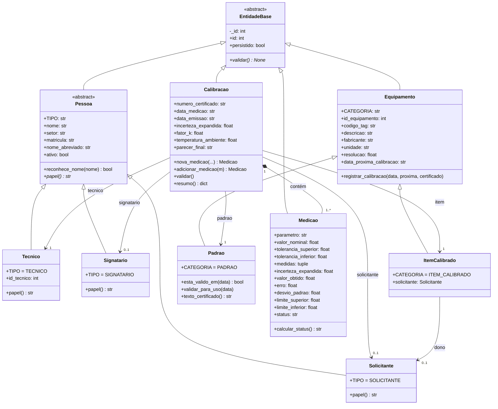
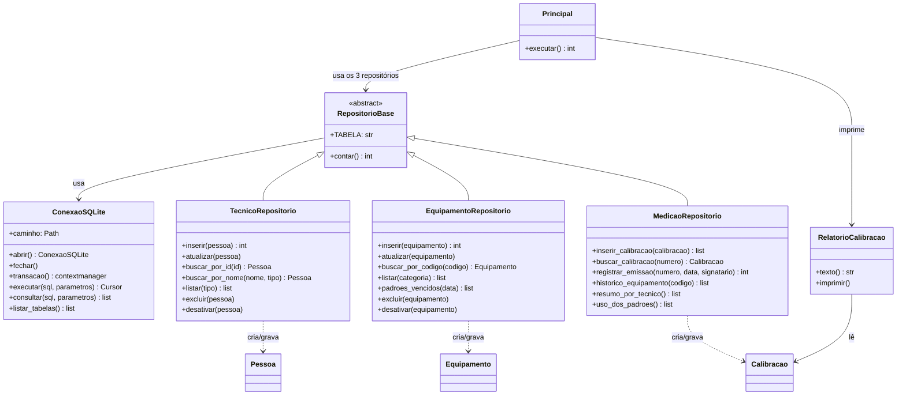

# 06 – MVP Parte 1: classes do sistema em POO (Python) e conexão com o SQLite

**Projeto Aplicado I 2026.2 – UniSENAI | Empresa parceira: Schulz S.A.**
**Tema:** automação da emissão de certificados de calibração
**Equipe:** Deivid Correa Borges, Fábio Luis Bezerra Marques, Gabriel Ricardo Lombardi,
Rodrigo de Souza Nascimento e Samuel Rodrigues Lopes Sobrinho
**Professores:** Prof. MSc. Hugo Menezes Barra e Prof. Rodrigo Losina

---

## 1. O que foi feito nesta fase

Na Fase 01 a gente levantou como a Schulz emite os certificados hoje e quais regras precisam ser
respeitadas. Na Fase 02 montamos o banco SQLite (técnicos, equipamentos e medições) e o script que
lê a saída da MMC/Calypso. Nesta fase o objetivo foi organizar tudo isso em classes.

Na prática, o código agora tem:

- classes que representam o técnico, o equipamento e a medição, e que já validam os dados
  (tolerância, validade do padrão, quem pode assinar etc.);
- uma classe de conexão com o SQLite e três repositórios que fazem `INSERT`, `SELECT`, `UPDATE` e
  `DELETE`;
- uma classe principal (`Principal`, no `05_main.py`) que pega os dados reais do certificado
  **00091/2026**, grava no banco, faz as consultas com `JOIN` e imprime o relatório no terminal.

| Item do roteiro | Arquivo | O que tem |
|---|---|---|
| 1. Classes de domínio e conexão SQL | `04_classes.py` | Classes de domínio, exceções, conexão, 3 repositórios e o relatório |
| 2. Classe principal de demonstração | `05_main.py` | Classe `Principal` com as 7 etapas da demonstração |
| 3. Documentação técnica | `06_mvp_parte1.md` | Este documento |
| Extra | `testes_mvp.py` | 34 testes automatizados (todos passando) |

**Por que Python e não Java:** o extrator da Fase 02 já estava em Python, então deu para
reaproveitar a leitura do Calypso sem reescrever nada. Além disso o `sqlite3` já vem com o Python,
não precisa configurar driver JDBC, e o projeto roda igual no VS Code em Windows, Linux e macOS.

## 2. Decisões que tomamos

Antes de começar o código relemos os relatórios das fases 01 e 02 e o material da Aula 02. Algumas
decisões vieram dali:

| Assunto | O que decidimos |
|---|---|
| Banco da Fase 02 | Não mexemos nas 3 tabelas nem nos triggers. As classes validam antes de mandar para o banco, e o banco continua barrando o que passar. |
| Nomes do roteiro | O roteiro fala em `id_tecnico`, `codigo_tag` e `descricao`, mas no banco as colunas são `id_pessoa`, `codigo` e `denominacao`. Deixamos os nomes do roteiro nas classes e o repositório faz a ligação com as colunas. |
| Cabeçalho repetido na tabela `medicao` | Na Fase 02 falamos em separar cabeçalho e resultados. Como o roteiro desta fase ainda usa as 3 tabelas como base, fizemos essa separação só no código: a classe `Calibracao` guarda o cabeçalho uma vez e tem a lista de `Medicao`. A divisão da tabela ficou para a Parte 2. |
| Técnico com dois nomes (achado A-06) | O método `reconhece_nome()` compara sem acento com o nome completo e com o nome abreviado do Calypso. |
| Sinal da tolerância inferior (achado A-03) | `limite_inferior = nominal + tolerancia_inferior`, porque a tolerância já vem negativa. Para os dados da Schulz isso dá o mesmo que a fórmula da Aula 02 (nominal − \|Tol. −\|). |
| Margem de ponto flutuante (Aula 02) | Usamos a mesma margem de `1e-7` mostrada em aula, para o float não reprovar um valor que está exatamente no limite. |
| Parecer final (Aula 02) | A `Calibracao` tem `parecer_final`: só dá APROVADO se todos os parâmetros estiverem dentro da tolerância. |
| Regra de decisão (pendência P-03) | A planilha da Schulz usa faixa de guarda (desconta a incerteza) e a Aula 02 compara direto com os limites. Deixamos as duas na classe `Medicao` (`FAIXA_GUARDA` e `SIMPLES`). No certificado 00091/2026 as duas dão o mesmo resultado: 8 aprovados e 6 reprovados. |
| Incerteza em µm (achado A-09) | A conversão para mm é feita uma vez só, quando a `Calibracao` é montada. |

## 3. Como o código está dividido

```
05_main.py  (classe Principal)        extrator.py (Fase 02: lê Calypso e planilhas)
     │                                        │
     ▼                                        ▼
┌──────────────────────────── 04_classes.py ────────────────────────────┐
│ Relatório      RelatorioCalibracao                                    │
│ Domínio        Pessoa ▸ Tecnico | Signatario | Solicitante            │
│                Equipamento ▸ ItemCalibrado | Padrao                   │
│                Calibracao ◆── Medicao                                 │
│ Persistência   TecnicoRepositorio | EquipamentoRepositorio |          │
│                MedicaoRepositorio  ──usa──▶  ConexaoSQLite            │
│ Erros          ErroValidacao | ErroPersistencia ▸ 4 subclasses        │
└───────────────────────────────────────────────────────────────────────┘
                                       │ sqlite3 (PRAGMA foreign_keys = ON)
                                       ▼
                    schulz_mvp.db  ←  03_banco.sql (3 tabelas + triggers)
```

A ideia foi não misturar as coisas: as classes de domínio não têm SQL nenhum, e os repositórios não
calculam status. Assim conseguimos testar a regra de tolerância sem precisar de banco.

## 4. Diagramas de classes (UML)

Os diagramas estão em Mermaid, que é texto e o GitHub desenha sozinho. As imagens também estão na
pasta `docs/`. Separamos em dois porque, num diagrama só, as setas ficavam cruzando tudo e não dava
para ler.

**Diagrama 1 – classes de domínio**



**Diagrama 2 – conexão, repositórios, relatório e classe principal** (as classes de domínio aparecem
só pelo nome)



Hierarquia das exceções:

```
Exception
└── ErroSistema (.regra)
    ├── ErroValidacao ............. a classe recusou o dado, antes do SQL
    └── ErroPersistencia (.original = mensagem que veio do SQLite)
        ├── RegistroDuplicado ..... UNIQUE (RN-10, RN-23)
        ├── ReferenciaInvalida .... FOREIGN KEY (RN-16, RN-22)
        ├── RegraNegocioViolada ... CHECK, NOT NULL e triggers (RN-01, RN-02, RN-05, RN-13, RN-25)
        └── RegistroNaoEncontrado . busca por id/código sem resultado
```

### 4.1 Qual classe vai em qual tabela

| Classe | Tabela | Como o repositório sabe qual classe criar |
|---|---|---|
| `Tecnico`, `Signatario`, `Solicitante` | `tecnico_solicitante` | coluna `tipo` |
| `ItemCalibrado`, `Padrao` | `equipamento` | coluna `categoria` |
| `Medicao` | `medicao` (uma linha por parâmetro) | – |
| `Calibracao` | colunas de cabeçalho da `medicao` (certificado, datas, padrão, pessoas, U e k) | – |

## 5. Conceitos de POO usados

| Conceito | Onde aparece | Por que usamos |
|---|---|---|
| Encapsulamento | Os atributos ficam com `_` na frente e o acesso é por `@property`. Os setters validam: `matricula` não aceita número (perderia o hífen, RN-07), `codigo_tag` transforma `500008` em `500.008` (TR-11) e `unidade` só aceita `mm` ou `um` (RN-06). | Não dá para criar um objeto com dado errado. |
| Imutabilidade | A `Medicao` só recebe nominal, tolerâncias e medidas no construtor e não tem setter para eles. | É a mesma regra do trigger que bloqueia alteração no banco (RN-02). |
| Abstração | `EntidadeBase`, `Pessoa` e `RepositorioBase` herdam de `ABC`, com `validar()` e `papel()` abstratos. | Toda entidade é obrigada a ter a sua validação. |
| Herança | `Pessoa` → `Tecnico`, `Signatario`, `Solicitante`; `Equipamento` → `ItemCalibrado`, `Padrao`. | Os atributos comuns ficam na classe mãe e cada filha só tem o que é dela (ex.: `Padrao.validar_para_uso()`). |
| Polimorfismo | `papel()` devolve um texto diferente em cada tipo de pessoa; o repositório cria a subclasse certa pela coluna `tipo`/`categoria`. | O relatório chama `pessoa.papel()` sem precisar de `if` para cada tipo. |
| Composição | A `Calibracao` tem as `Medicao` e numera a sequência delas. | Medição não existe sem certificado, e parâmetro repetido é recusado (RN-10). |
| Repositório (DAO) | `TecnicoRepositorio`, `EquipamentoRepositorio`, `MedicaoRepositorio`. | Todo o SQL fica num lugar só. |
| Gerenciador de contexto | `with ConexaoSQLite(...)` e `with conexao.transacao():` | A conexão sempre fecha e a transação faz commit ou rollback sozinha. |
| Exceções próprias | `ErroValidacao`, `ErroPersistencia` e subclasses, com o código da regra. | O usuário vê "RN-05: padrão vencido" e não um `IntegrityError`. |

Exemplo de setter com validação (classe `Pessoa`):

```python
@matricula.setter
def matricula(self, valor) -> None:
    # RN-07: identificador é texto. Um número viria do Excel sem o hífen e sem zeros à esquerda.
    if isinstance(valor, (int, float)) and not isinstance(valor, bool):
        raise ErroValidacao("Matrícula deve ser informada como texto (ex.: '16858-0')", "RN-07")
    ...
```

Uma coisa que mudamos no meio do caminho: no começo o `Signatario` era filho de `Tecnico`. Só que
aí um signatário passava no `isinstance(..., Tecnico)` e podia ser gravado como técnico executante,
o que o banco não aceita (o trigger exige tipo `TECNICO`). Por isso criamos a `Pessoa` como classe
mãe e deixamos os três papéis como irmãos.

## 6. Como a classe `Medicao` decide o status

```
valor_obtido    = média das medidas (1 ou 2)
erro            = valor_obtido - valor_nominal
limite_superior = valor_nominal + tolerancia_superior
limite_inferior = valor_nominal + tolerancia_inferior      (a tolerância inferior já tem sinal)

FAIXA_GUARDA (padrão, igual à planilha da Schulz):
    REPROVADO se (obtido + U) > limite_superior + 1e-7  ou  (obtido - U) < limite_inferior - 1e-7
SIMPLES (igual à Aula 02):
    REPROVADO se  obtido      > limite_superior + 1e-7  ou   obtido      < limite_inferior - 1e-7

Parecer final da calibração: APROVADO só se todos os parâmetros forem APROVADO.
```

Exemplo com os dados reais (U = 0,002 mm):

| Parâmetro | Obtido | Limites | Obtido ± U | Status |
|---|---|---|---|---|
| 62P_DIÂMETRO 1 | 6,0787 | [6,065; 6,085] | [6,0767; 6,0807] | APROVADO |
| 62P_POSIÇÃO 1 | 0,4296 | [0,000; 0,100] | [0,4276; 0,4316] | REPROVADO |

O status não é digitado, ele é sempre calculado. Quando o certificado é lido de volta do banco, a
propriedade `status_confere_com_banco` compara o status gravado com o recalculado, e nas 14 linhas
bateu. Como os 6 parâmetros de posição ficaram acima de 0,100 mm, o parecer final deu REPROVADO. O
certificado oficial da Schulz não mostra status, então isso continua como informação interna até a
Schulz confirmar a regra (pendência P-03).

## 7. Conexão e persistência

A `ConexaoSQLite` faz o seguinte:

1. abre o banco com `sqlite3.connect` e usa `sqlite3.Row`, para pegar as colunas pelo nome;
2. liga o `PRAGMA foreign_keys = ON` e confere se ligou mesmo (no SQLite isso vem desligado);
3. se o banco estiver vazio, roda o `03_banco.sql` da Fase 02;
4. todos os comandos usam parâmetros `?`. Nunca juntamos valor dentro do texto do SQL, o que evita
   SQL injection (por exemplo, um nome de parâmetro com aspas vindo do arquivo do Calypso);
5. o `transacao()` junta vários comandos: ou grava tudo ou não grava nada (RN-29).

| Operação | Método | SQL |
|---|---|---|
| Inserir pessoa | `TecnicoRepositorio.inserir` | `INSERT INTO tecnico_solicitante` |
| Atualizar pessoa | `TecnicoRepositorio.atualizar` | `UPDATE tecnico_solicitante ... WHERE id_pessoa = ? AND tipo = ?` |
| Buscar pessoas | `buscar_por_id`, `buscar_por_matricula`, `buscar_por_nome`, `listar` | `SELECT ... FROM tecnico_solicitante` |
| Excluir pessoa | `TecnicoRepositorio.excluir` / `desativar` | `DELETE` (só sem histórico) / `UPDATE ... ativo = 0` |
| Inserir equipamento | `EquipamentoRepositorio.inserir` | `INSERT INTO equipamento` |
| Atualizar equipamento | `EquipamentoRepositorio.atualizar` | `UPDATE equipamento ... WHERE id_equipamento = ?` |
| Excluir equipamento | `EquipamentoRepositorio.excluir` / `desativar` | `DELETE` (só sem histórico) / `UPDATE ... ativo = 0` |
| Padrões vencidos | `padroes_vencidos(data)` | `SELECT ... WHERE data_proxima_calibracao < ?` |
| Gravar certificado | `MedicaoRepositorio.inserir_calibracao` | um `INSERT INTO medicao` por parâmetro, numa transação |
| Ler certificado | `MedicaoRepositorio.buscar_calibracao` | `SELECT` com `JOIN` em `equipamento` (2 vezes) e `tecnico_solicitante` (3 vezes) |
| Registrar emissão | `MedicaoRepositorio.registrar_emissao` | `UPDATE medicao SET data_emissao = ?, id_signatario = ?` |
| Relatórios | `historico_equipamento`, `resumo_por_tecnico`, `uso_dos_padroes` | `JOIN` / `LEFT JOIN` com `GROUP BY` |

Medição não tem método de exclusão, porque o histórico não pode ser apagado (RN-16 e RN-25). Já
técnico e equipamento podem ser excluídos só se não tiverem nenhuma medição ligada. Se tiverem, a
chave estrangeira bloqueia e a mensagem sugere usar o `desativar()`. No `UPDATE` da medição só dá
para mudar a data de emissão e o signatário; valores medidos e status o trigger da Fase 02 bloqueia.

## 8. Tratamento de erros do SQL

Todo erro do `sqlite3` passa pela função `traduzir_erro_sqlite()`. Ela devolve uma exceção nossa,
com a regra de negócio, e guarda a mensagem original do SQLite em `.original` para conferência:

| Mensagem do SQLite | Exceção | Regra | Exemplo |
|---|---|---|---|
| `UNIQUE constraint failed` | `RegistroDuplicado` | RN-10 | matrícula 16858-0 repetida |
| `FOREIGN KEY constraint failed` | `ReferenciaInvalida` | RN-22 / RN-16 | excluir o técnico José ou o item 703.1208, que têm histórico |
| `NOT NULL constraint failed` | `RegraNegocioViolada` | RN-01 | medição sem data |
| `CHECK constraint failed` | `RegraNegocioViolada` | depende da expressão | data `13/08/2026` fora do formato AAAA-MM-DD |
| `RN-xx: ...` (trigger) | `RegraNegocioViolada` | lida da mensagem | alterar medida (RN-02), excluir medição (RN-25), padrão vencido (RN-05) |
| `OperationalError` | `ErroPersistencia` | – | banco não encontrado ou tabela que não existe |

A mesma regra é conferida em dois lugares. Primeiro na classe, antes de abrir a transação, com uma
mensagem fácil de entender (ex.: `Padrão 500.011 vencido em 31/08/2026 (medição em 15/09/2026)`).
Depois no banco, pelos CHECK, FK e triggers, que barram até quem tenta gravar direto no SQLite sem
passar pelo sistema. Se der erro fora de uma transação, a conexão faz rollback; dentro do
`transacao()`, desfaz a transação inteira. O `05_main.py` pega qualquer `ErroSistema` e termina com
código 1, sem aquele monte de linhas de erro do Python na tela.

## 9. Testando o fluxo

Comando: `python 05_main.py` (cria um `schulz_mvp.db` novo cada vez que roda, separado do banco da
Fase 02).

| Etapa | O que acontece | O que aparece na saída |
|---|---|---|
| 1. Conexão | Cria as 3 tabelas e liga as chaves estrangeiras | `tabelas: ['equipamento', 'medicao', 'tecnico_solicitante']` |
| 2. INSERT | 2 técnicos, 31 áreas, 1 signatário, 8 padrões e 1 item, tirados das planilhas da Schulz | aviso A-07: "Usinagem I" não estava na lista |
| 3. UPDATE e DELETE | O técnico "José A. Rosa Jr" recebe nome completo e matrícula; o item recebe a área dona; um técnico de teste é gravado e excluído | `matrícula=None -> matrícula=16858-0`; `DELETE de teste ... excluído` |
| 4. Certificado | 14 objetos `Medicao` montados a partir do Report do Calypso, status calculado, gravação numa transação e depois o UPDATE da emissão | `14 medições (id 1 a 14)` |
| 5. JOIN | Certificado, histórico do item, medições por técnico e uso dos padrões | `00091/2026`: 14 parâmetros, 8 aprovados, 6 reprovados |
| 6. Relatório | Certificado montado de novo a partir do banco e impresso | valores obtidos e erros iguais aos do certificado da Schulz |
| 7. Erros | 15 tentativas de gravar ou mudar dado errado | `15 de 15 tentativas inválidas recusadas`; o banco continua com 14 medições |

Parte do relatório que sai no terminal:

```
CERTIFICADO DE CALIBRAÇÃO Nº 00091/2026                                         Data: 26/08/2026
Solicitante: Usinagem I
...
4. Resultados (mm)
   Nº  Parâmetro avaliado    Nominal  Tol. +  Tol. -   Obtido    Erro  Status*
    1  PLANICIDADE_REF         0,000   0,050   0,000    0,002   0,002  APROVADO
    3  62P_DIÂMETRO 1          6,075   0,010  -0,010    6,079   0,004  APROVADO
    4  62P_POSIÇÃO 1           0,000   0,100   0,000    0,430   0,430  REPROVADO
   ...
5. Incerteza de medição: 0,002 mm    k = 2,23
Técnico executante: Jose Alcides Rosa Junior (matrícula 16858-0)
Signatário autorizado: João Carlos Gomes de Oliveira
Resumo: 14 parâmetros | 8 aprovados | 6 reprovados
PARECER FINAL*: INSTRUMENTO REPROVADO
```

**Testes automatizados** (`python testes_mvp.py`): 34 testes, todos passando. São 8 da regra de
status, 12 das classes de domínio, 13 de banco e tratamento de erro, e 1 que roda o `05_main.py`
inteiro e compara os 14 resultados com o certificado 00091/2026. Rodamos também os testes da Fase 02
(`python testes_regras.py`) e continuam 37 de 37, ou seja, o banco não foi afetado.

## 10. Dificuldades que tivemos

- **Importar o `04_classes.py`.** Como o roteiro pede o nome começando com número, o
  `import 04_classes` dá erro de sintaxe. Resolvemos com `importlib.import_module("04_classes")`.
- **Signatário herdando de técnico.** Explicado na seção 5: a herança deixava um signatário passar
  como técnico, então mudamos a hierarquia.
- **Transação dentro de transação.** O cadastro inicial abre uma transação e chama os repositórios,
  que também gravam. Se cada repositório desse commit por conta própria, uma falha no meio deixaria
  metade do cadastro gravado. Por isso colocamos um contador na `ConexaoSQLite`: só a transação de
  fora faz o commit ou o rollback, e um teste confere isso.
- **Ponto flutuante.** Num teste, 0,7 + 0,1 deu 0,7999999999999999, e uma medida de exatamente 0,8
  ficou reprovada. Adotamos a margem de `1e-7` que o professor mostrou na Aula 02.
- **Status gravado x calculado.** Só confiar no status que estava gravado não garantia que ele
  estivesse certo. Por isso a classe recalcula o status quando lê do banco e compara com o gravado.
- **Diagrama UML.** Num diagrama só, com todas as classes, ficou ilegível. Dividimos em dois.

## 11. Como rodar

```bash
pip install -r requirements.txt
python 05_main.py                          # demonstração completa
python 05_main.py --relatorio 00091/2026   # só o relatório, usando o banco já gerado
python testes_mvp.py                       # 34 testes do MVP
```

No Windows, se o `python` não funcionar, use `py`. O `schulz_mvp.db` abre no VS Code com a extensão
SQLite Viewer.

## 12. O que fica para a Parte 2

- Trocar o arquivo `complemento_00091-2026.json` por uma tela onde o técnico preenche os dados que não
  vêm do Calypso (RF-04).
- Gerar o certificado em PDF a partir do `RelatorioCalibracao` (RF-11), com revisão e aprovação
  (RF-12 e RF-13).
- Separar a tabela `medicao` em cabeçalho e resultados. Como a `Calibracao` já separa isso no código,
  só os repositórios vão precisar mudar.
- Usuários e perfis (RF-19) e registro das operações para auditoria (RF-14).
- Confirmar com a Schulz a regra de decisão (P-03), qual MMC foi usada (P-01) e os dados dos outros
  padrões (P-07). O padrão 500.011 vale até 31/08/2026; enquanto o novo certificado dele não for
  cadastrado (P-06), o sistema não aceita calibração com ele depois dessa data.
