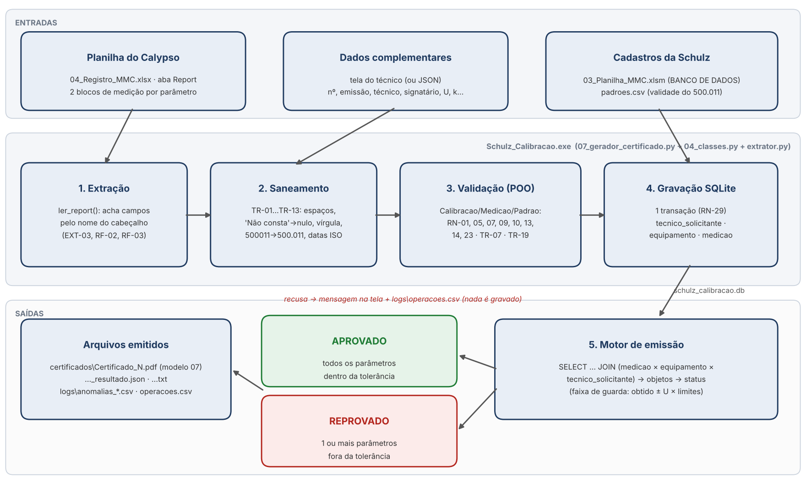
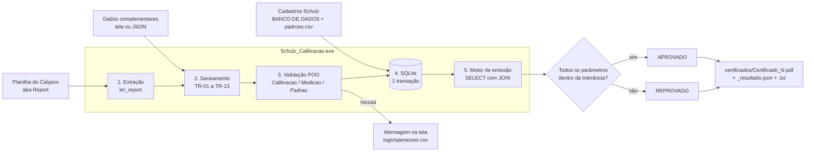
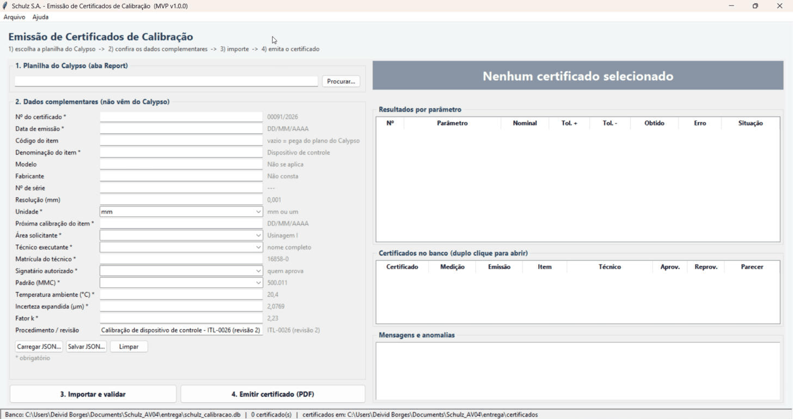
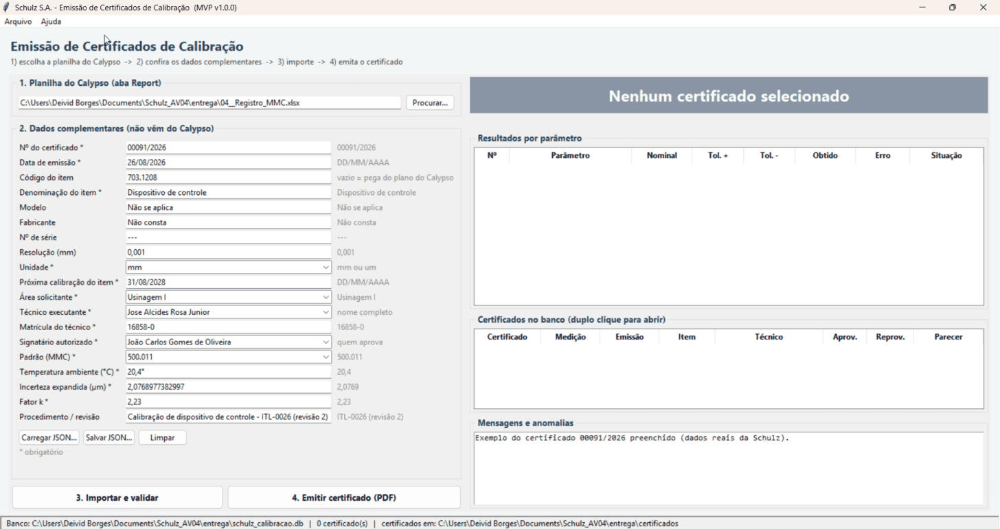
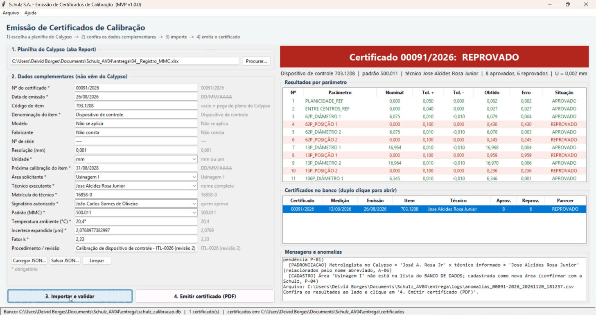
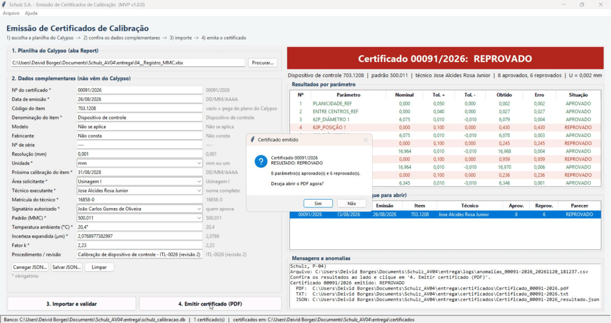
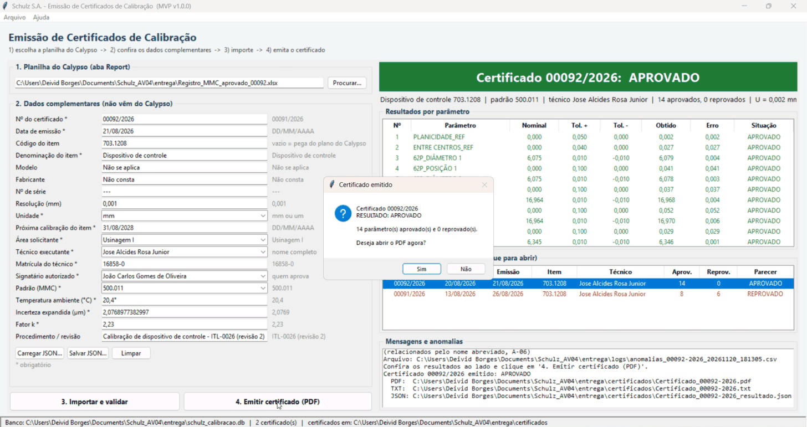
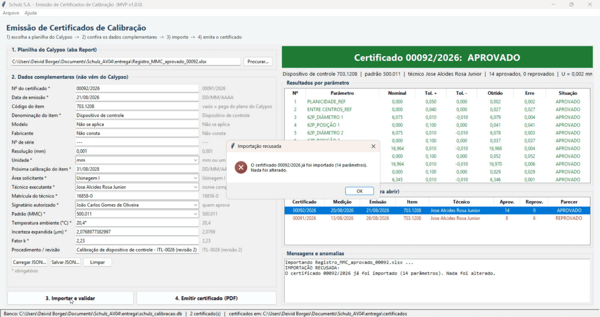
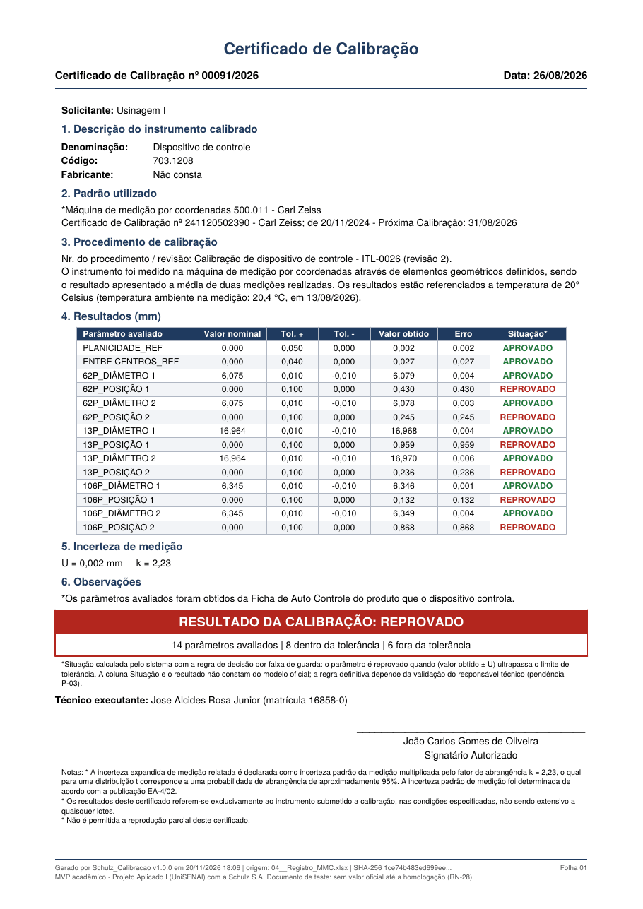

# 08 – MVP final: documentação técnica e manual do usuário

**Projeto Aplicado I 2026.2 – UniSENAI | Empresa parceira: Schulz S.A.**
**Tema:** automação da emissão de certificados de calibração
**Equipe:** Deivid Correa Borges, Fábio Luis Bezerra Marques, Gabriel Ricardo Lombardi,
Rodrigo de Souza Nascimento e Samuel Rodrigues Lopes Sobrinho
**Professores:** Prof. MSc. Hugo Menezes Barra e Prof. Rodrigo Losina
**Repositório:** https://github.com/DeividCS/schulz-certificados-calibracao

---

## 1. O que foi feito nesta fase

Até a Fase 03 o sistema só rodava pelo terminal do VS Code (`python 05_main.py`) e lia os dados
complementares de um arquivo JSON. Nesta fase juntamos tudo num programa que o técnico de metrologia
abre com dois cliques, sem instalar Python:

- **Módulo de ingestão (ETL):** lê a planilha do Calypso, aplica as regras de higienização da Fase 01 e
  grava nas 3 tabelas do SQLite numa transação só;
- **Motor de emissão:** consulta o certificado com `JOIN`, recalcula o status de cada parâmetro e dá o
  resultado final **APROVADO** ou **REPROVADO**, gerando o certificado em PDF no layout do modelo da Schulz;
- **Interface:** uma tela (tkinter) com os 4 passos do processo e a lista de certificados do banco;
- **Executável:** `Schulz_Calibracao.exe`, gerado com o PyInstaller, que roda no Windows sem Python.

| Item do roteiro | Arquivo | O que tem |
|---|---|---|
| 1. Módulo integrado de ingestão e gerador de certificados | `07_gerador_certificado.py` | ETL, motor de emissão (JOIN), PDF, interface e plano de testes |
| 2. Executável e evidência de build | `entrega/Schulz_Calibracao.exe`, `build_exe.bat`, `Schulz_Calibracao.spec`, `entrega/evidencia_build.txt` | O .exe, o script de build e o resultado dos testes rodando no próprio .exe |
| 3. Documentação final e manual | `08_mvp_final_manual.md` | Este documento |
| Apoio | `gerar_dados_teste.py`, `dados/testes/` | Planilhas usadas nos casos de teste |

Continuamos em **Python**, como na AV 03. Os arquivos das fases anteriores não foram alterados: o
`07_gerador_certificado.py` importa o `04_classes.py` (classes e repositórios) e o `extrator.py`
(leitura do Calypso e funções TR) e usa o mesmo `03_banco.sql`.

## 2. Arquitetura final integrada

### 2.1 Fluxo ponta a ponta





### 2.2 Camadas do código

```
┌─────────────────────── 07_gerador_certificado.py ───────────────────────┐
│ Interface      JanelaPrincipal (tkinter)       main(): linha de comando │
│ Serviço        ServicoCalibracao: importar() | emitir() | listar()      │
│ Saída          GeradorCertificadoPDF (reportlab)  |  PlanoDeTestes      │
│ Entrada        DadosComplemento.sanear()  (RF-04, TR-01 a TR-13)        │
└───────────────┬──────────────────────────────────────┬──────────────────┘
                │ usa                                  │ usa
     extrator.py (Fase 02)                  04_classes.py (Fase 03)
     ler_report, limpar_texto,              Tecnico, Signatario, Solicitante,
     para_real, para_data_iso,              ItemCalibrado, Padrao, Medicao,
     codigo_padrao, sha256                  Calibracao + repositórios
                                                       │ sqlite3
                                                       ▼
                                  schulz_calibracao.db ← 03_banco.sql (Fase 02)
```

A interface não tem regra de negócio: ela só chama o `ServicoCalibracao`. Por isso a mesma lógica
roda pela tela, pela linha de comando e pelo plano de testes.

### 2.3 Módulo de ingestão (ETL)

`ServicoCalibracao.importar(planilha, complemento)` faz, nesta ordem:

| Etapa | O que faz | Regras |
|---|---|---|
| Formato | Aceita só `.xlsx`/`.xlsm` e exige a aba `Report` com as colunas `Characteristic … Deviation` | RF-02, EXT-03 |
| Saneamento do que o técnico digitou | Tira espaços sobrando, troca "Não consta"/"---" por nulo, aceita vírgula decimal, converte `500011` em `500.011`, datas para AAAA-MM-DD, junta todos os erros numa mensagem só | TR-01, 02, 06, 09, 11, 12, RN-01 |
| Extração | Junta os dois blocos de medição por parâmetro e confere `Deviation = Actual − Nominal` | RF-03, RF-09 |
| Campo vazio | Se um valor medido estiver vazio, **bloqueia** (não vira zero) e grava o log | TR-07, RN-01 |
| Duplicidade | Recusa número de certificado repetido e o mesmo arquivo do Calypso (SHA-256) importado de novo | RN-10, RN-23, TR-19 |
| Cadastros | Carrega técnicos, áreas e padrões das planilhas sem duplicar; liga o técnico do Calypso ("José A. Rosa Jr") ao nome completo | RN-22, A-06 |
| Validação | `Calibracao.validar()`: padrão válido na data, papéis corretos, tolerâncias coerentes; signatário diferente do técnico | RN-05, 09, 13, 14 |
| Gravação | Tudo dentro de `conexao.transacao()`: se der erro em qualquer ponto, nada fica gravado | RN-29 |
| Registro | Anomalias em `logs/anomalias_<cert>_<data>.csv`; cada operação em `logs/operacoes.csv` (data, usuário do Windows, resultado) | RF-14, RF-18 |

### 2.4 Motor de emissão

`ServicoCalibracao.emitir(numero)`:

1. roda o `SQL_CERTIFICADO` do `MedicaoRepositorio` — `medicao JOIN equipamento (item) JOIN equipamento
   (padrão) JOIN tecnico_solicitante (técnico) LEFT JOIN tecnico_solicitante (solicitante e signatário)`;
2. remonta os objetos `Calibracao` e `Medicao` e **recalcula** o status de cada parâmetro. Se algum status
   gravado for diferente do recalculado, a emissão é bloqueada (RN-19);
3. aplica a regra: o parâmetro é **REPROVADO** quando `(obtido + U) > nominal + Tol.+` ou
   `(obtido − U) < nominal + Tol.−` (faixa de guarda da planilha da Schulz, com o sinal corrigido – achado A-03),
   com margem de `1e-7` para o ponto flutuante;
4. o certificado é **APROVADO** só se todos os parâmetros forem aprovados;
5. gera `certificados/Certificado_<n>.pdf` (layout do modelo 07), um `.txt` com o mesmo relatório e um
   `_resultado.json` com o parecer, as medições, a versão do algoritmo e o SHA-256 da planilha de origem (RN-18, RN-21).

O PDF segue as seções 1 a 6 do modelo da Schulz e acrescenta a coluna **Situação** e uma faixa com o
resultado (verde ou vermelha). No rodapé fica escrito que é um documento de teste do MVP, sem valor
oficial até a homologação (RN-28), porque a regra de decisão ainda depende do responsável técnico (P-03).

## 3. Guia de geração do executável (build)

**Pré-requisitos:** Windows 10/11 e Python 3.10 a 3.14 **x64**. Se não houver Python, o
`build_exe.bat` tenta instalar o 3.12 x64 pelo `winget`.

Passo a passo (é o que o `build_exe.bat` faz sozinho):

```bat
cd Schulz_AV04
py -m venv .venv-build
.venv-build\Scripts\activate
pip install -r requirements.txt -r requirements-build.txt   :: openpyxl, reportlab, pyinstaller
python gerar_dados_teste.py                                  :: planilhas do plano de testes
python testes_mvp.py                                         :: 34 testes da Fase 03
pyinstaller --clean --noconfirm Schulz_Calibracao.spec       :: gera dist\Schulz_Calibracao.exe
```

Depois ele monta a pasta `entrega\`, copia o .exe e a planilha de exemplo, roda
`Schulz_Calibracao.exe --testes` e grava `entrega\evidencia_build.txt`.

Decisões do `Schulz_Calibracao.spec`:

| Configuração | Por quê |
|---|---|
| Arquivo único (`onefile`), `console=False` | O técnico recebe um .exe só e abre direto a janela, sem o terminal preto |
| `hiddenimports=["04_classes", "extrator", …]` | O `04_classes` é carregado com `importlib` (o nome começa com número), então o PyInstaller não o encontra sozinho |
| `datas`: `03_banco.sql`, `dados/` | O DDL e os cadastros da Schulz vão dentro do .exe; o programa acha esses arquivos em `sys._MEIPASS` |
| Banco, certificados e logs ao lado do .exe | No .exe a pasta de trabalho é a do `sys.executable`, então o técnico vê o `schulz_calibracao.db` e a pasta `certificados` |
| Python x64 | O .exe x64 roda em qualquer Windows x64 e também em Windows ARM (emulação). Um .exe ARM64 não rodaria nos PCs x64 |
| `excludes` de matplotlib/numpy/pandas | Deixa o .exe menor (≈ 22 MB) |

**Evidência do build** (`entrega/evidencia_build.txt`, gerado no notebook do Deivid em 20/11/2026):

```
Interpretador do build : Python 3.14.5 win-amd64
PyInstaller            : 6.22.3
Executável             : entrega\Schulz_Calibracao.exe (PE32+ GUI x86-64), 22796981 bytes
SHA-256                : 16802d87395fcf76c0011fb8f77120045d67d18d7141c61dc18c212c9868aa08
Testes no .exe         : RESULTADO: 13 de 13 casos de teste passaram
```

## 4. Manual do usuário (técnico de metrologia da Schulz)

### 4.1 Instalação

Não precisa instalar nada. Copie a pasta `entrega` para o computador e dê dois cliques em
`Schulz_Calibracao.exe`. Na primeira vez o Windows pode mostrar "O Windows protegeu o computador"
(o .exe não tem assinatura digital): clique em **Mais informações → Executar assim mesmo**.
O programa cria, na mesma pasta, o banco `schulz_calibracao.db` e as pastas `certificados`, `logs` e `complementos`.

### 4.2 Tela principal



A esquerda tem os passos 1 a 4. A direita mostra o resultado do certificado selecionado, os
resultados de cada parâmetro, a lista de certificados do banco e as mensagens.

### 4.3 Emitir um certificado

1. **Planilha do Calypso** – clique em **Procurar…** e escolha a planilha exportada pela MMC (com a aba `Report`).
2. **Dados complementares** – preencha o que não vem do Calypso. Os campos com `*` são obrigatórios.
   Área solicitante, técnico, signatário e padrão têm lista para escolher (vêm do cadastro).
   Pode digitar número com vírgula (`20,4`, `2,0769`). Para não digitar tudo de novo, use
   **Salvar JSON…** e **Carregar JSON…**. Para conhecer o programa use **Ajuda → Preencher exemplo 00091/2026**.

   

3. **Importar e validar** – o programa lê a planilha, confere tudo e grava no banco. Se tiver
   problema, aparece uma janela explicando o que corrigir e **nada é gravado**. Avisos que não
   impedem a emissão (por exemplo, MMC 500.008 no Calypso x padrão 500.011 informado) aparecem em
   **Mensagens e anomalias** e ficam salvos em `logs\`.

   

4. **Emitir certificado (PDF)** – gera o PDF e mostra o resultado: faixa **verde (APROVADO)** quando
   todos os parâmetros estão dentro da tolerância ou **vermelha (REPROVADO)** quando um ou mais estão fora.
   As linhas reprovadas ficam em vermelho na tabela. O programa pergunta se quer abrir o PDF.

   

   Exemplo de certificado **aprovado** (planilha de teste `Registro_MMC_aprovado_00092.xlsx`, que vai na pasta `entrega`):

   

   Quando algo está errado a importação é recusada com a explicação, e nada é gravado (aqui, o mesmo certificado importado duas vezes):

   

### 4.4 Certificado gerado



### 4.5 Consultar um certificado antigo

Clique no certificado na lista **Certificados no banco**: os resultados aparecem acima. Dê duplo
clique para emitir o PDF de novo. Os arquivos ficam em **Arquivo → Abrir pasta de certificados**.

### 4.6 Mensagens mais comuns

| Mensagem | O que fazer |
|---|---|
| `campo obrigatório (RN-01)` | Preencha o campo indicado |
| `fora do formato 00091/2026 (RN-23)` | Use 5 dígitos, barra e o ano |
| `já foi importado` | O certificado (ou a mesma planilha) já está no banco: selecione-o na lista |
| `Padrão 500.011 vencido em 31/08/2026 (RN-05)` | Cadastre o novo certificado do padrão no `padroes.csv` (pendência P-06) ou use outro padrão válido |
| `resultado(s) sem valor (TR-07)` | A planilha do Calypso está incompleta: exporte de novo |
| `aba obrigatória 'Report' não encontrada` | Escolha a planilha exportada pelo Calypso, não a planilha de cálculo |
| `O signatário não pode ser o próprio técnico (RN-14)` | Quem assina tem que ser outra pessoa |

### 4.7 Uso pela linha de comando (opcional)

```bat
Schulz_Calibracao.exe --importar planilha.xlsx --complemento dados.json --emitir
Schulz_Calibracao.exe --emitir-certificado 00091/2026
Schulz_Calibracao.exe --listar
Schulz_Calibracao.exe --testes          :: roda o plano de testes (banco separado)
```

## 5. Plano de testes

Os casos estão no próprio programa (classe `PlanoDeTestes`). Eles rodam com
`Schulz_Calibracao.exe --testes` ou pelo menu **Ajuda → Executar plano de testes**, usam um banco
separado (`resultados_testes\banco_teste.db`) e gravam `relatorio_testes.txt`, `casos_de_teste.csv`,
os PDFs e os logs. As planilhas de teste saem do arquivo real do Calypso mudando só o necessário
(`gerar_dados_teste.py`).

| Caso | Cenário | Entrada | Esperado | Obtido no .exe |
|---|---|---|---|---|
| CT-01 | Certificado real da Schulz | `04__Registro_MMC.xlsx` + dados do 00091/2026 | REPROVADO (8 aprovados, 6 reprovados) | REPROVADO ✔ |
| CT-02 | Signatário igual ao técnico | Signatário = José Alcides | Recusado (RN-14) | Recusado ✔ |
| CT-03 | Dispositivo dentro da tolerância | `Registro_MMC_aprovado_00092.xlsx` | APROVADO (14 de 14) | APROVADO ✔ |
| CT-04 | Certificado repetido | 00091/2026 de novo | Recusado (RN-23) | Recusado ✔ |
| CT-05 | Mesma planilha com outro número | 00093/2026 com o arquivo do 00091 | Recusado (TR-19) | Recusado ✔ |
| CT-06 | Padrão vencido | Medição em 15/09/2026; 500.011 vale até 31/08/2026 | Recusado (RN-05) | Recusado ✔ |
| CT-07 | Planilha fora do formato | Sem a aba `Report` | Recusado (RF-02) | Recusado ✔ |
| CT-08 | Valor medido apagado | Um `Actual` vazio | Recusado (RN-01/TR-07), sem trocar por zero | Recusado ✔ |
| CT-09 | Dados complementares inválidos | Número `97/26` e signatário vazio | Recusado, com os 2 erros juntos | Recusado ✔ |
| CT-10 | Saneamento | `"  Usinagem    I "`, `Não consta`, `500011`, `20,4 °C`, `2,0768977` µm | `Usinagem I`, nulo, `500.011`, 20,4, 0,002 mm | Saneado ✔ |
| CT-11 | Limite exato e faixa de guarda | 0,8 com limite 0,7+0,1; 6,083 e 6,0835 com U = 0,002 | Aprovado, aprovado, reprovado | ✔ |
| CT-12 | Consulta com JOIN | Lista do banco depois dos testes | Só 00091 e 00092 gravados | ✔ |
| CT-13 | Fidelidade ao certificado da Schulz | Valores obtidos do 00091/2026 | 14 de 14 iguais ao modelo 07 | ✔ |

**Resultado: 13 de 13 casos passaram no executável** (além dos 34 testes do `testes_mvp.py`).
Os recusados não gravam nada: o CT-12 confirma que só os dois certificados válidos ficaram no banco.

Trecho do `relatorio_testes.txt` gerado pelo .exe:

```
PLANO DE TESTES - Schulz_Calibracao v1.0.0 | 2026-11-20 18:15:41 | usuário Deivid Borges
Python 3.14.5 | executável: sim | algoritmo: calc-1.0 (média de 2 medições, faixa de guarda com U em mm, margem 1e-7)

[CT-01] Certificado real 00091/2026 (Report do Calypso da Schulz)
    Esperado: REPROVADO
    Obtido:   REPROVADO
      00091/2026: 14 parâmetros, 8 aprovados, 6 reprovados | anomalias registradas: 6 | PDF: Certificado_00091-2026.pdf
    => PASSOU

[CT-03] Dispositivo com todas as posições dentro da tolerância (00092/2026)
    Esperado: APROVADO
    Obtido:   APROVADO
      00092/2026: 14 parâmetros, 14 aprovados, 0 reprovados | anomalias registradas: 4 | PDF: Certificado_00092-2026.pdf
    => PASSOU

[CT-06] Medição em 15/09/2026 com o padrão 500.011 vencido em 31/08/2026
    Esperado: RECUSADO (RN-05)
    Obtido:   RECUSADO (RN-05)
      Padrão 500.011 vencido em 31/08/2026 (medição em 15/09/2026)
    => PASSOU

(...)
RESULTADO: 13 de 13 casos de teste passaram
```

## 6. Dificuldades e soluções

- **Gerar .exe no notebook ARM.** O notebook do Deivid é Windows ARM. Usamos o Python **x64** (roda
  emulado) para o .exe sair x64 e funcionar nos computadores da faculdade e da Schulz.
- **`04_classes` dentro do .exe.** O PyInstaller não acha módulo importado por `importlib`. Declaramos em
  `hiddenimports` e, por garantia, o programa também consegue carregar o `.py` embutido.
- **Caminhos no .exe.** Dentro do .exe os arquivos ficam numa pasta temporária. Separamos `RECURSOS`
  (DDL e cadastros, dentro do .exe) de `PASTA_APP` (banco e certificados, ao lado do .exe).
- **Sem console.** Com `console=False` o `print` quebra o programa (`sys.stdout` é `None`). Redirecionamos
  a saída para `saida_console.log`.
- **Mesma planilha duas vezes.** O roteiro pede para não duplicar; além do número do certificado,
  passamos a comparar o SHA-256 do arquivo (TR-19).
- **Tela em notebook.** A primeira versão cortava a parte de baixo numa tela de 768 px; a janela agora
  abre maximizada e as tabelas ficaram mais baixas.

## 7. Conclusões

O MVP cobre o caminho completo que hoje é feito à mão na planilha 06: a saída do Calypso entra, passa
pelas regras de higienização, é validada pelas classes, fica guardada no SQLite com histórico e
rastreabilidade, e sai como certificado em PDF com o resultado APROVADO/REPROVADO. Com os dados reais
do certificado 00091/2026 os 14 valores obtidos ficaram iguais ao certificado emitido pela Schulz, e o
sistema recusou todos os cenários de erro do plano de testes sem gravar nada pela metade.

Requisitos da Fase 01 atendidos no MVP: RF-01 a RF-11, RF-14, RF-16 e RF-18 (total ou parcialmente).

O que fica para uma próxima versão, antes de usar em produção:

- **P-03:** confirmar com o responsável técnico a regra de decisão (faixa de guarda x comparação simples);
  as duas já estão na classe `Medicao`;
- **P-06/P-07:** cadastrar o novo certificado do padrão 500.011 (vence em 31/08/2026) e os dados dos
  outros 7 padrões;
- **RF-12, RF-13, RF-19:** login com perfis de revisor e aprovador e assinatura no sistema;
- separar a tabela `medicao` em cabeçalho e resultados (a classe `Calibracao` já faz essa separação);
- assinatura digital do .exe, para o Windows não mostrar o aviso na primeira execução.

## 8. Como rodar pelo código (VS Code)

```bash
pip install -r requirements.txt
python 07_gerador_certificado.py           # abre a interface
python 07_gerador_certificado.py --testes  # plano de testes
build_exe.bat                              # gera o executável (Windows)
```
