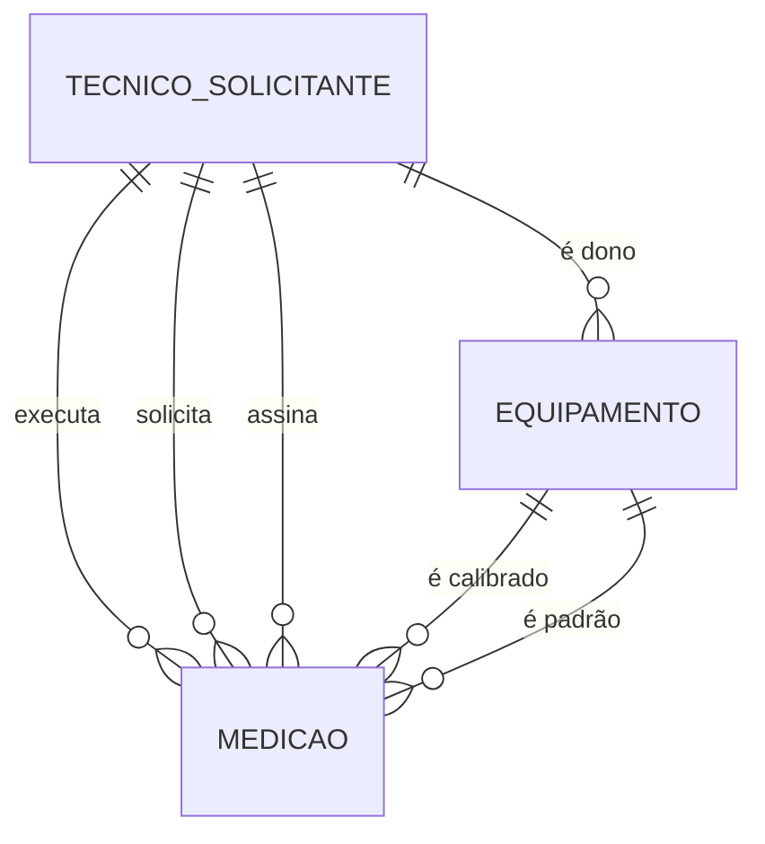

# Automação da emissão de certificados de calibração – Schulz S.A.

Projeto Aplicado I 2026.2 – UniSENAI · Orientadores: Prof. MSc. Hugo Menezes Barra e Prof. Rodrigo Losina

**Fase 04 – MVP final: ingestão das planilhas, emissão do certificado e executável Windows**
(as Fases 01 a 03 continuam no repositório e foram reaproveitadas sem alteração)

Equipe: Deivid Correa Borges · Fábio Luis Bezerra Marques · Gabriel Ricardo Lombardi ·
Rodrigo de Souza Nascimento · Samuel Rodrigues Lopes Sobrinho

## Arquivos

### Fase 04 – MVP final e executável

| Arquivo | Conteúdo |
|---|---|
| `07_gerador_certificado.py` | Ingestão (ETL) com saneamento, motor de emissão (JOIN no SQLite), certificado em PDF, interface gráfica (tkinter) e plano de testes |
| `08_mvp_final_manual.md` | Arquitetura final (fluxo ponta a ponta), guia de build, manual do usuário ilustrado, plano de testes e conclusões |
| `build_exe.bat` | Gera `entrega\Schulz_Calibracao.exe`, roda os testes no .exe e grava `evidencia_build.txt` |
| `Schulz_Calibracao.spec` / `versao_exe.txt` | Receita do PyInstaller (arquivo único, sem console) e dados de versão do .exe |
| `requirements-build.txt` | PyInstaller (só para gerar o .exe) |
| `gerar_dados_teste.py` / `dados/testes/` | Planilhas usadas nos 13 casos de teste (aprovado, padrão vencido, sem aba Report, valor vazio) |
| `docs/` | Fluxo ponta a ponta e capturas de tela do manual |
| `entregas/` | PDFs consolidados entregues no AVA (AV 01 a AV 04) |

O `Schulz_Calibracao.exe` não é versionado (é gerado pelo `build_exe.bat`); ele vai na pasta `entrega` do ZIP postado no AVA.

### Fase 03 – MVP Parte 1

| Arquivo | Conteúdo |
|---|---|
| `04_classes.py` | Classes de domínio (`Tecnico`, `Signatario`, `Solicitante`, `ItemCalibrado`, `Padrao`, `Medicao`, `Calibracao`), conexão `ConexaoSQLite`, repositórios com INSERT/SELECT/UPDATE/DELETE e tradução dos erros do SQLite |
| `05_main.py` | Classe `Principal`: cria os objetos, grava, atualiza, exclui, consulta com JOIN, imprime o relatório de calibração e testa 15 registros inválidos |
| `06_mvp_parte1.md` | Documentação técnica: padrões de POO, diagramas UML, tratamento de erros SQL e validação do fluxo |
| `testes_mvp.py` | 34 testes automatizados (unittest) |
| `docs/` | Diagramas UML em imagem |

### Fase 02 – Banco de dados

| Arquivo | Conteúdo |
|---|---|
| `01_estrutura.md` | Modelo conceitual: as 3 entidades e por que evitar duplicidade |
| `02_dicionario.md` | Dicionário de dados: 53 campos com tipo (Texto, Real, Inteiro), origem e regra |
| `03_banco.sql` | Script DDL: 3 tabelas com PK, FK, CHECK e triggers das regras de negócio |
| `04_consultas.sql` | Consultas de apoio (certificado, histórico, padrões vencidos, tabelas) |
| `extrator.py` | Lê a aba `Report` do Calypso, saneia os dados e grava no SQLite |
| `consultar.py` | Executa as consultas do `04_consultas.sql` sem instalar o sqlite3 |
| `testes_regras.py` | 37 verificações: estrutura, certificado 00091/2026, bloqueios e script |
| `dados/04__Registro_MMC.xlsx` | Saída do Calypso (amostra fornecida pela Schulz) |
| `dados/03__Planilha_MMC.xlsm` | Aba BANCO DE DADOS com técnicos, padrões e áreas |
| `dados/padroes.csv` | Dados do padrão 500.011 (aba Padrões) |
| `dados/complemento_00091-2026.json` | Dados do certificado que não existem no Calypso, com a célula de origem |

## Como executar a Fase 04

Usuário final (Windows): copie a pasta `entrega` e dê dois cliques em `Schulz_Calibracao.exe`.

Desenvolvimento:

```bash
pip install -r requirements.txt
python 07_gerador_certificado.py           # abre a interface
python 07_gerador_certificado.py --testes  # 13 casos de teste (grava resultados_testes/)
build_exe.bat                              # Windows: gera o executável e a pasta entrega/
```

## Como executar a Fase 03

```bash
pip install -r requirements.txt
python 05_main.py                          # demonstração completa (cria schulz_mvp.db)
python 05_main.py --relatorio 00091/2026   # só o relatório de calibração
python testes_mvp.py                       # 34 testes do MVP
```

## Como executar a Fase 02 no VS Code (Windows, Linux ou macOS)

1. Instale o Python 3.10 ou superior e, no VS Code, a extensão **SQLite Viewer** para abrir o banco.
2. No terminal do VS Code (no Windows, troque `python` por `py` se o comando não for encontrado):
   ```bash
   pip install -r requirements.txt
   python extrator.py --somente-estrutura   # opcional: cria só as 3 tabelas vazias
   python extrator.py                       # importa o certificado 00091/2026
   python consultar.py                      # mostra a tabela de resultados do certificado
   python testes_regras.py                  # roda as 37 verificações
   ```
3. Para importar de novo do zero (somente em teste): `python extrator.py --recriar`.
   Sem essa opção, o script **não apaga** o banco: ele acumula o histórico e recusa um certificado já importado.
4. As anomalias encontradas em cada importação ficam em `logs/anomalias_<certificado>_<data>.csv`.

Quem tiver o `sqlite3` instalado também pode usar `sqlite3 schulz_calibracao.db < 03_banco.sql`.

## Modelo



## Observações

- Os arquivos `.sql` não usam acentos nos comentários e nas mensagens de propósito, para evitar
  problemas de codificação em terminais Windows. Os demais arquivos usam UTF-8 com acentos.
- Os arquivos em `dados/` são amostras reais fornecidas pela Schulz para fins acadêmicos.
  Mantenha o repositório **privado** e adicione o professor como colaborador (regra RN-26 da Fase 01).
